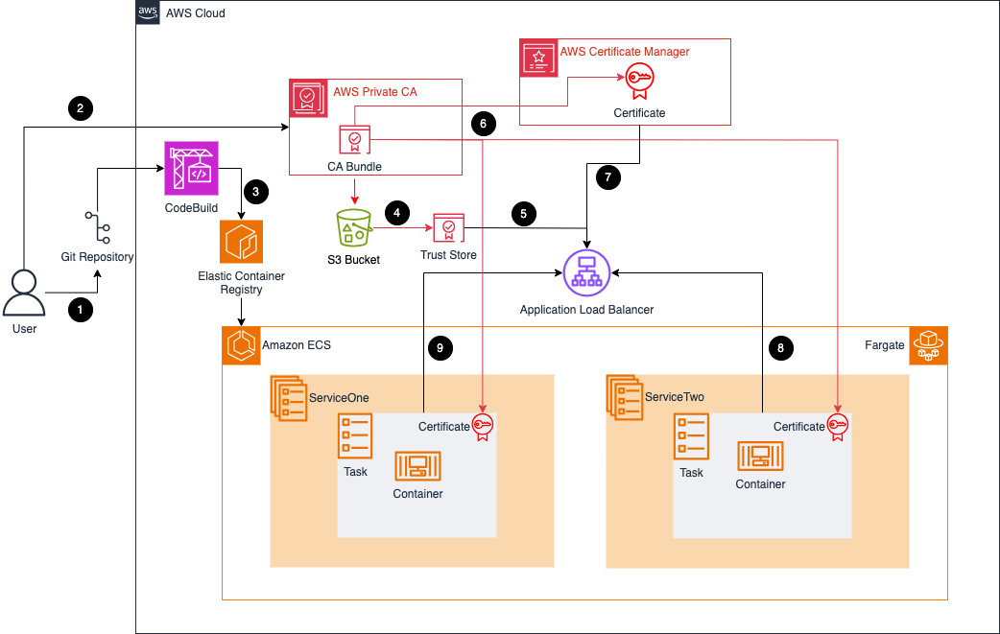

# Simplify application authentication with mutual TLS in Amazon ECS by using Application Load Balancer

## mTLS with Application Load Balancer in Amazon ECS

This pattern provides guidance for implementing [Mutual Transport Layer Security](https://en.wikipedia.org/wiki/Mutual_authentication) (mTLS) in Amazon Elastic Container Service (Amazon ECS) by using [Application Load Balancer (ALB)](https://docs.aws.amazon.com/elasticloadbalancing/latest/application/mutual-authentication.html) to authenticate X.509 client certificates from AWS Private Certificate Authority (PCA). The pattern use Amazon Elastic Container Registry (Amazon ECR) to store container images.

The pattern helps you to simplify your application authentication and offload security burdens with mutual TLS (mTLS) in Amazon ECS using Application Load Balancer. This powerful combination ensures secure communication between your services, reducing the need for complex authentication mechanisms within your applications.

The example in this pattern uses docker images from public gallery to initially create the sample workloads, and subsequently building new docker images to be stored in Amazon ECR. For the source, consider a Git-based system such as GitHub, GitLab, or Bitbucket, or use Amazon Simple Storage Service (Amazon S3). For building the docker images, consider using AWS CodeBuild for the subsequent images.

## Prerequisites

- [AWS Account](https://signin.aws.amazon.com/signin?redirect_uri=https%3A%2F%2Fportal.aws.amazon.com%2Fbilling%2Fsignup%2Fresume&client_id=signup&code_challenge_method=SHA-256&code_challenge=XEEgw2-l_BhdGq9gejjCnbmOG9-bgXnWTm7f-20KOTk) with an access to deploy CloudFormation stacks. The identity that deploys the stack also needs `kms:CreateGrant`, `kms:RetireGrant` and `kms:DescribeKey`, because the Amazon ECR repositories are [encrypted with an AWS KMS key](https://docs.aws.amazon.com/AmazonECR/latest/userguide/encryption-at-rest.html) created by the template.
- Install [AWS CLI](https://docs.aws.amazon.com/cli/latest/userguide/getting-started-install.html) latest version.
- Install [OpenSSL](https://www.openssl.org/)
- Familiarity with AWS services, including Amazon ECS and Fargate
- Knowledge of Docker, NGINX
- AWS Credentials: You will need to configure on your local machine or in your environment by either using the [AWS CLI](https://docs.aws.amazon.com/cli/latest/userguide/welcome-examples.html) or by setting the environment variables in the ~/.aws/credentials file.

## Architecture Diagram

1. You create a Git repository and commit the application code to the repository.
2. You Create a private CA in AWS Private CA
3. You create CodeBuild project. The AWS CodeBuild project is triggered by commit changes and creates the Docker image and publishes the built image to Amazon ECR.
4. You copy the certificate chain and certificate body from CA and upload the certificate bundle to Amazon Simple Storage Service
5. Create a trust store with the CA bundle uploaded to S3 and associate the trust store with the mTLS listeners on the Application Load Balancer.
6. Use the private CA to issue a client certificates for the container workloads. Also create a private TLS certificate using the AWS Private CA.
7. You import private TLS certificate into ACM and use it with the Application load balancer.
8. Container workload in the ServiceTwo uses the issued client certificate to authenticate with Application load balancer when it needs to communicate with the other container workload in the ServiceOne
9. Container workload in the ServiceOne uses the issued client certificate to authenticate with Application load balancer when it needs to communicate with the other container workload in the ServiceTwo

## Steps required

The list below is a summary. [quickstart.md](quickstart.md) contains the detailed commands for each step.

- Create a private [CA in AWS Private CA](https://docs.aws.amazon.com/privateca/latest/userguide/create-CA.html)
- Create and [install your private CA certificate](https://docs.aws.amazon.com/privateca/latest/userguide/PCACertInstall.html)
- Issue private [end-entity certificates](https://docs.aws.amazon.com/privateca/latest/userguide/PcaIssueCert.html) for the two services
- Retrieve your [CA certificate from AWS Private CA](https://docs.aws.amazon.com/privateca/latest/userguide/PcaGetCert.html)
- In ACM, [request a private PKI certificate signed by a CA from AWS Private CA](https://docs.aws.amazon.com/acm/latest/userguide/gs-acm-request-private.html#request-private-cli)
- Deploy the [CloudFormation template](./apg-infra.yaml) (first pass). The services run zero tasks until mutual TLS is enabled
- Upload the CA bundle and client certificates to the stack's S3 bucket, then delete the local private keys
- Build your own docker images and push them to Amazon ECR with a unique (commit) tag
- Update the stack (second pass) with the CA bundle key and image URIs. The stack creates the trust store, enables mutual TLS (`Mode=verify`) on both listeners, and starts the services

> **Note:** This is sample code. The sample builds each service's client private key into its container image for simplicity. For production use, store the key in AWS Secrets Manager and inject it at task start, restrict image pulls and ECS Exec, restrict who can issue certificates from the CA (`acm-pca:IssueCertificate`, `acm:ExportCertificate`) and update the trust store, authorize callers per service, and automate certificate rotation and revocation. See [Production considerations](quickstart.md#production-considerations).

## Guidance

For a step-by-step guidance on implementing this pattern see [quickstart.md](quickstart.md), or refer to the documentation on the APG site:
[Simplify application authentication with mutual TLS in Amazon ECS by using Application Load Balancer](https://docs.aws.amazon.com/prescriptive-guidance/latest/patterns/simplify-application-authentication-with-mutual-tls-in-amazon-ecs.html)

## Continuous integration

| Workflow | What it does |
|---|---|
| [Checkov](.github/workflows/checkov.yml) | Scans the CloudFormation template [`apg-infra.yaml`](apg-infra.yaml) with [Checkov](https://www.checkov.io/) on every push and pull request to `main`, and uploads the results to GitHub code scanning |

Checkov checks skipped in this project, and why

Skips are declared on the affected resource in the template (`Metadata.checkov.skip`), not for the
whole scan, so the check still applies to every other resource.

| Check | Description | Resource | Reason |
|---|---|---|---|
| CKV_AWS_18 | Ensure the S3 bucket has access logging enabled | `AccessLogBucket` | This bucket is the server access log destination for the other buckets in the stack. Amazon S3 [does not recommend a bucket logging to itself](https://docs.aws.amazon.com/AmazonS3/latest/userguide/enable-server-access-logging.html) because it creates an infinite loop of log records, and a log destination bucket cannot use S3 Object Lock. |

The template also carries two [cfn-guard](https://github.com/aws-cloudformation/cloudformation-guard) suppressions (`Metadata.guard.SuppressedRules`) for the same reasons: `S3_BUCKET_LOGGING_ENABLED` and `S3_BUCKET_DEFAULT_LOCK_ENABLED` on `AccessLogBucket`, and `NO_UNRESTRICTED_ROUTE_TO_IGW` on `PublicRoute`, because the public subnets only host the NAT gateways that give the private subnets outbound internet access.

## Security

See [CONTRIBUTING](CONTRIBUTING.md#security-issue-notifications) for more information.

## License

This library is licensed under the MIT-0 License. See the LICENSE file.

